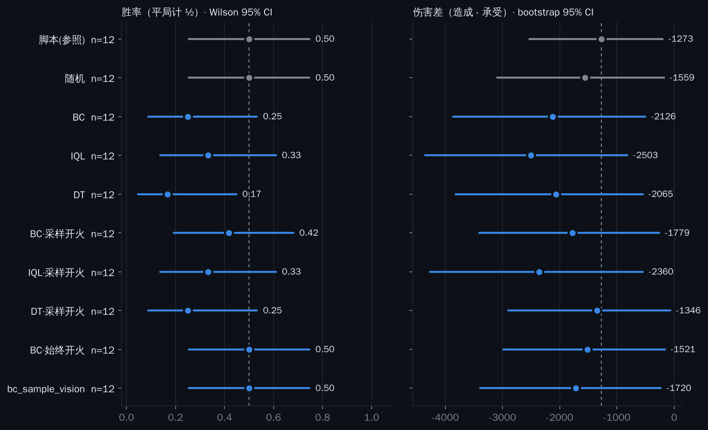

<div align="center">


# RMUC-OfflineRL

**基于官方 *RMUC2026 区域赛数据集* 的全兵种自主决策离线强化学习框架**

北师香港浸会大学（BNBU）· **Navigator 战队** · 算法组


</div>

---

## 项目概述

RoboMaster 超级对抗赛（RMUC）官方于7月18日在论坛发布了 [RMUC 2026区域赛部分赛事数据](https://bbs.robomaster.com/article/1936220)

数据公开了 613 局真实比赛的裁判系统日志，共 400 万条逐秒状态记录。本项目基于以上公布数据的内容格式，搭建了一套**适用于全兵种决策策略训练的离线强化学习框架**，并使用**IQL, BC, Decision Transformer**三种算法进行了离线强化学习训练的尝试与效果评估。结论显示模型能够**初步学习到人类步兵的战术模式**。

框架覆盖日志解析 → 观测 / 动作 / 奖励构建 → 多卡训练 → 离线评估 → 部署接口，全兵种通用


## 目录

- [项目概述](#项目概述)
- [前言](#前言)
- [问题建模](#问题建模)
- [结论摘要](#结论摘要)
- [数据集](#数据集)
- [设计](#设计)
  - [为什么用步兵数据训练哨兵策略](#为什么用步兵数据训练哨兵策略)
  - [观测空间（161 维）](#观测空间161-维)
  - [动作空间（tactical，10 维）](#动作空间tactical10-维)
  - [可见性代理（经验交火图）](#可见性代理经验交火图)
  - [队伍强度先验（防泄漏）](#队伍强度先验防泄漏)
  - [奖励](#奖励)
  - [算法与超参](#算法与超参)
- [结果](#结果)
  - [训练](#训练)
  - [决策质量（best checkpoint，held-out）](#决策质量best-checkpointheld-out)
  - [离线策略评估（FQE）](#离线策略评估fqe)
  - [评估的局限](#评估的局限)
- [可视化](#可视化)
- [快速开始](#快速开始)
  - [1. 获取数据](#1-获取数据)
  - [2. 安装环境](#2-安装环境)
  - [3. 运行](#3-运行)
- [代码结构](#代码结构)
- [部署](#部署)
- [计划](#计划)
- [Jev 评估](#jev-评估)
- [仿真闭环（Arena-1）](#仿真闭环arena-1)
- [2027 哨兵决策层（Arena-1 自博弈）](#2027-哨兵决策层arena-1-自博弈)
- [参考](#参考)
- [团队与引用](#团队与引用)
- [License](#license)
- [Star History](#star-history)

## 前言

构建 RMUC 场景下的多智能体强化学习模型,实现哨兵乃至全兵种的自主协同作战，是作者参加 RM 三年来的一个畅想。但这是一个极其复杂且前沿的课题，落地存在诸多困难：难以从录像回放中解析出观测数据，难以对全场比赛建模，也没有能支撑强化学习训练的仿真平台——现有模拟器均未开放裁判系统数据级别的接口，且无法并行训练。加之作者能力有限，这一设想便长期停留在纸面上。直到近日官方开源了 RMUC 赛场的真实数据,初步尝试才具备了可能。

欢迎对 RM 强化学习感兴趣的朋友参与项目讨论，共同推进强化学习及相关机器人前沿技术在 RM 赛场的落地。

作者邮箱：harkerbest@foxmail.com
项目讨论 QQ 群：653155513


## 问题建模

由于没法反复重开一局去试错，所以这是一个**离线强化学习**问题。我们把它建模成 **1 Hz 的战术决策**，策略每秒读取 161 维的战场状态，并输出三个通道的动作：**去哪**（导航子目标）、**打谁**（6 台敌方中选一个，或不交战）、**能不能开火**。走位、云台和扳机等控制在 1 Hz 的控制频率上没有意义，因此不在模型动作空间范围内。虽然裁判系统日志里没有模型动作标注，但是这三个通道都可以由状态反推得到。

策略学习使用了三种算法，共享同一套接口以便横向对比：

| 算法 | 定位 | 说明 |
|---|---|---|
| **IQL** | 主方法 | 训练中从不查询数据之外的动作，不会被高估的 Q 值带偏，是离线场景下最稳的一类方法 |
| **BC / %BC** | 基线 | 直接模仿日志动作。既是"纯模仿能到什么水平"的水平线，也是后文对消评估偏置的零点 |
| **Decision Transformer** | 对照 | 把决策当作"给定目标回报的序列生成"，用 Transformer 预测动作，绕开价值函数 |

对于哨兵策略，由于日志里的哨兵轨迹其实就是各队自己写的行为树，而离线 RL 学不过它的示范者。所以我们改用**人类操作的步兵**数据训练，再把策略迁移到哨兵上，以此提高哨兵策略的潜力。


## 结论摘要

| 结论 | 证据强度 |
|---|---|
| 策略能学到人类步兵的战术模式：6 台敌方中选对交战目标 **74.6%**（随机 16.7%） | **可靠**（held-out 监督指标） |
| 用人类操作的**步兵**数据训练，比用全自主**哨兵**数据学到更多决策：扣除基线后 **+0.341 vs +0.215** | **可靠**（同上） |
| IQL / Decision Transformer 相对行为克隆**没有可测量的增益**（偏置对消后 ±0.6 内） | **可靠**（BC 校准对消估计器偏置） |
| 闭环中 IQL 相对 BC 同样**没有可测量的提升**（Arena-1 仿真，同局配对伤害差 −377，95% CI −895 ~ +38） | **中等**（仿真；每组 12 局） |
| 按 `p_fire > 0.5` 部署，三个策略都**显著不如**仿真里的脚本步兵；门控改为按 `p_fire` 采样后差距不再显著 | **中等**（同上） |
| 策略是否强于各队现役哨兵脚本 | **无法判定**（离线不可判；Arena-1 仿真中也未超过其脚本步兵，见[仿真闭环](#仿真闭环arena-1)） |
| 策略是否强于人类步兵 | **几乎否定**（离线模仿的理论上限，且实测 IQL≈BC） |


## 数据集

数据集为 2026 RoboMaster 超级对抗赛（RMUC）东部 / 南部 / 北部三大区域赛的比赛过程数据。包含613 局真实比赛的裁判系统日志，共 400 万条逐秒状态记录。数据格式 SQLite，内含三张表，使用`game_id` 关联。

| 表 | 行数 | 内容 |
|---|---|---|
| `matches` | 613 | 赛区、对阵、胜方、时长 |
| `timeseries` | 4,015,383 | 某局某秒某机器人的完整状态 |
| `events` | 1,474,178 | 发弹 / 受击 / 能量机关 / 飞镖 / 增益 |

经过观察，数据集存在以下特征：

- 采样率 **1 Hz**，单局约 420 s。`robot_id`：红方 1 英雄 / 2 工程 / 3 步兵3 / 4 步兵4 / 6 空中 / 7 哨兵 / 10 基地 / 11 前哨站；蓝方 +100。场地 28 m × 15 m。
- **`枪口朝向` = `atan2(dy,dx)` 的角度值，零偏移**，取值 wrap 到 [−140, 220]。扫描 72 种约定/偏移组合确定。
- **−140.0 是"无云台数据"哨兵值**，工程 / 基地 / 前哨站恒为此值，用于瞄准推断前必须排除。
- **`events.目标robot_id` 对全部 120 万条 `发弹` 与 25 万条 `受击` 均为 NULL**，仅 384 条 `飞镖命中` 有值 → **无法做逐机器人伤害归因** → 采用队伍级奖励。
- **数据中不存在任何视线/可见性字段**。坐标来自场地全局定位而非机器人感知；`x=y=0` 表示裁判系统丢失跟踪（哨兵 2.3%，其余 <1%）。场地障碍图也不在数据中。
- **升级等级可观测**：`最大血量` 步兵 11 种取值（150→400）、英雄 15 种（150→450）；`小热量上限` 步兵 19 种（40→260）；`大热量上限` 英雄 16 种（100→240）；`底盘功率` 逐秒连续。
- 胜负最相关的是前哨站；**基地被摧毁 1226 例中仅 1 例**，奖励不应以拆基地为目标。
- 96 支队伍，每队中位 12 场（6–22）。


## 设计

### 为什么用步兵数据训练哨兵策略

离线 RL 的性能上限是它的示范者。哨兵在 RMUC 中是全自主的，日志里的哨兵轨迹多为各队自己的行为树。步兵是**人类操作**且与哨兵**构造等价**，因此人类步兵的决策更具备学习价值。

场上数据统计：

全部 613 场、共 3554 条单机单场轨迹的统计（空间指标为 1 m 栅格、**单场**平均，可由 [`viz/heatmaps.py`](viz/heatmaps.py) 复现）：

| 指标 | 哨兵 | 步兵3 | 步兵4 |
|---|---|---|---|
| 最大血量取值 | 400（恒定） | 150→400（11 种） | 150→400（11 种） |
| 17mm 热量上限 | 260（恒定） | 40→260（20 种） | 40→260（20 种） |
| 场均发弹 | 186 | 167 | 168 |
| 走过格数（1 m 栅格，共 420 格） | **25.4** | 73.2 | 74.2 |
| 位置熵（nats） | **1.76** | 3.49 | 3.50 |
| 时间集中度（前 5 格） | **81.4%** | 40.5% | 40.3% |
| 跨队走位余弦相似度 | **0.200** | 0.383 | 0.408 |

- 哨兵恒为 400 血 / 260 热上限，正是步兵满级后的规格，同为 17mm，发弹量相当——**哨兵等价于一台锁定满级的步兵**。英雄不适用（42mm，热上限 50 / 240）。（1180 场中有 1 场哨兵记录为 200 血 / 100 热，占 0.1%，按异常样本处理。）

- 哨兵轨迹的覆盖面积约为步兵的 1/3、位置熵约为一半，且 **81% 的时间集中在 5 个格子内**（步兵 40%），可学的决策内容显著更少。

- 跨队相似度上哨兵（0.20）**低于**步兵（0.38–0.41）：并非各队哨兵跑同一套脚本，而是各有各的固定岗位；人类步兵反而跨队趋同。见 [可视化](#可视化)一节的分队对比图。

- 发弹量还有一处旁证：步兵的场均与中位数几乎重合（167 / 162），哨兵却是 186 / 118 的重尾分布——同一兵种在不同队伍手里差异极大，正符合"各队各写一套脚本"。

- 默认训练目标 `AGENT=infantry`（步兵3 + 步兵4 合并，数据翻倍）。

**跨兵种迁移的两个必要设计**：

1. 队伍观测块为**固定 6 槽位**（含 ego 自身，相对位置为 0），而非"排除自己的 5 个队友"——后者使列语义随兵种改变，迁移不成立。
2. **不加兵种 one-hot**。实测加入 `is_ego` 标志后，把步兵策略部署为哨兵时该标志落在训练中恒为 0 的列上，**策略退化为每帧输出完全相同的指令**。移除后哨兵迁移正常（goal 标准差 1.32 / 1.75，出现 5 种目标），英雄仍退化——即该设计只在构造真正等价处成立。

### 观测空间（161 维）

| 块 | 维度 | 内容 |
|---|---|---|
| ego | 15 | 位置(2) 高度 血量比 存活 易伤 热量比 热量余量 功率 sin/cos朝向 弹量 + **血量档 / 17mm档 / 42mm档** |
| 时间 | 2 | 已用 / 剩余 |
| 队伍槽位 | 6 × 9 = 54 | 相对位置(2) 距离 血量比 存活 + **能力档位(4)**；固定顺序，含 ego 自身 |
| 敌方 | 6 × 12 = 72 | 相对位置(2) 距离 血量比 存活 易伤 位置已知 + **能力档位(4)** + **交火可见性先验** |
| 建筑 | 8 | 双方基地 / 前哨站 血量与存活 |
| 经济 | 4 | 己方剩余 / 总额、对方总额、差额 |
| 对手先验 | 6 | 己方与对手各 3 个匿名强度标量 |

**能力档位（每实体 4 维）**：`最大血量 / 最大血量_满级`、`小热量上限 / 260`、`大热量上限 / 240`、`底盘功率 / 120`。前三者共同编码该单位当前升级等级，使策略能区分"对面英雄 450 血三级"与"150 血一级"。

蓝方经 180° 镜像映射到红方坐标系，策略侧别无关，数据翻倍。`--vis-radius` / `--vis-dropout` 可构建半可观测版本。

### 动作空间（tactical，10 维）

| 通道 | 维度 | 分布 | 说明 |
|---|---|---|---|
| 导航子目标 | 2 | Gaussian | `goal_horizon=5` 秒后的位移，米 |
| 交战门控 | 1 | Bernoulli | 该秒是否允许开火 |
| 目标选择 | 7 | Categorical（**软标签**） | 6 台敌方 + "无目标" |

**标签来源与验证**：

- 交战门控：由 `累计17mm发弹` 差分直接读出，**精确标签**。
- 目标选择：日志不记录射击对象，由 `枪口朝向` 与各敌方方位角的夹角反演。

| 指标 | 开火的秒 | 未开火的秒 |
|---|---|---|
| 到最近存活敌方的最小角误差（中位） | **6.7°** | 42.1° |
| 15° 锥内有敌方的比例 | **77.5%** | 33.7% |

信号明确，但**锥内存在 >1 个敌方的情形占 55.5%**，归属存在真实歧义。因此采用软标签：锥内敌方按 `softmax(−误差/τ)` 分配概率质量（`cone=15°`, `τ=8°`），锥内无敌方则全部质量给"无目标"。

离散头（Bernoulli + Categorical）天然多模态，同时解决了早期版本中 MSE + 单高斯头对多模态目标做均值回归的问题。

动作归一化：仅导航通道除以 `act_scale`（各数据集 |动作| 的 99 分位）。实测 **步兵 7.468 / 7.907 m，哨兵 5.096 / 5.376 m**。

### 可见性代理（经验交火图）

数据无视线信息，场地障碍图也不可得。改用行为反推：统计全赛季"从格子 A 向格子 B 实际发生交火"的次数，除以两者同时在场的次数。2 m 栅格（14×8 = 112 格），锥角 15°，Laplace 平滑后除以全局交火率，截断到 [0, 4]。40 场上格子对覆盖率 58.9%，全局交火率 0.0319，比值跨度 0.01–4.00。→ [`vis_map.py`](rm_rl/data/vis_map.py)

### 队伍强度先验（防泄漏）

每队每场输出 3 个标量：历史胜率、攻击性（场均发弹 / 联盟均值）、耐久（场均受伤 / 联盟均值）。两条约束：

1. **严格因果**：只用该队此前的比赛，按 `开始时间`, `game_id` 排序展开累计。
2. **匿名**：不输出队伍身份或 embedding，避免"遇到某校就怎么打"这种不泛化的记忆。

构建结果 1226 条记录中恰 96 条为冷启动（= 96 支队伍各自的第一场），从结构上验证了因果顺序。→ [`team_prior.py`](rm_rl/data/team_prior.py)

### 奖励

队伍视角逐秒塑形：前哨/基地掉血、队伍消耗、击杀/阵亡、自身存活、经济、热量超限，加终局胜负项。权重全部在 config 中。

以逻辑回归从胜负反演权重做验证：**AUC 0.976、准确率 0.918**，13 个权重中 12 个符号与人工设定一致。唯一例外为"自身掉血"，数据显示其与胜负近乎无关，据此将 `w_ego_hp` 由 1.5 下调至 0.2。→ [`reward_model.py`](rm_rl/data/reward_model.py)

### 算法与超参

| 算法 | 角色 | 网络 | 步数 |
|---|---|---|---|
| **IQL** | 主方法 | MLP 256×2，三头 | 20k |
| **BC / %BC** | 基线 | 同上 | 15k |
| **Decision Transformer** | 对照 | n_embd 128 / 3 层 / 4 头，ctx 30 | 20k |

公共训练设置：`batch=1024`（DT 128）、AdamW `lr=3e-4`（DT 1e-4）、`weight_decay=1e-4`、warmup 500、余弦调度、`grad_clip=1.0`、`expectile=0.7`、`beta=1.0`、`gamma=0.99`、`polyak=0.005`、奖励自动归一化至单位方差。

`eval_every=1000`，`early_stop_patience=8`，按 `action_mse` 保存 `best.pt`。**训练产物请用 `best.pt`，不要用 `final.pt`**。

各算法均为单一 `nn.Module`，`forward` 返回损失，直接适配 `DistributedDataParallel`。

## 结果

数据：步兵（步兵3 + 步兵4），**903,272 训练 / 99,570 验证转移，2165 条轨迹**。

### 训练

| 运行 | best 落点 | 备注 |
|---|---|---|
| infantry IQL | step 13000 / 20000 | 健康 |
| infantry BC | step 9000 | 早停触发 |
| infantry DT | step 16000 / 20000 | 健康 |

### 决策质量（best checkpoint，held-out）

**必须对照基线读**，原始准确率会因类别不均衡而失真。

| | 步兵（人类） | 哨兵（脚本） |
|---|---|---|
| `nav_mse` | 0.0603 | 0.0532 |
| `fire_f1` | 0.3750 | 0.4081 |
| ↳ 正样本率 | 0.1614 | 0.1024 |
| `target_top1` | 0.8320 | 0.8393 |
| ↳ "永远无目标"基线 | 0.4907 | 0.6243 |
| ↳ **相对基线提升** | **+0.3413** | +0.2150 |
| `target_top1_named`（6 台中选对哪台） | **0.7455** | 0.6661 |
| ↳ 相当于随机（0.1667）的 | **4.5×** | 4.0× |

哨兵版原始 `target_top1` 看似相当，但其任务基线高得多（0.624 vs 0.491）。扣除基线后步兵数据训练出的目标决策明显更强。开火时机则哨兵更易预测（脚本的开火条件是确定的）。

### 离线策略评估（FQE）

`Δ = J(策略) − J(行为)`。

| 策略 | 评估数据 | J(π) | Δ | 校准后 Δ |
|---|---|---|---|---|
| 步兵 IQL | 步兵行为 | −7.523 | −8.903 | **+0.021** |
| 步兵 BC | 步兵行为 | −7.544 | −8.924 | （零点） |
| 步兵 DT | 步兵行为 | −8.123 | −9.503 | −0.579 |
| 哨兵 IQL | 哨兵行为 | −9.159 | −10.740 | −0.175 |
| 哨兵 BC | 哨兵行为 | −8.984 | −10.565 | （零点） |
| 哨兵 DT | 哨兵行为 | −9.270 | −10.851 | −0.286 |
| 步兵 IQL → | 哨兵行为 | −9.961 | −11.543 | 不可比 |

**Δ 的绝对值几乎全是估计器偏置，不是策略质量。** 判据：BC 是对行为的直接模仿，若估计器无偏其 Δ 应约等于 0，实测为 **−8.92 / −10.57**。成因是日志行为随机多模态而评估用确定性动作，Q 落在支撑集外，twin-Q 取 min 系统性悲观；每步约 0.1 的悲观乘以 γ=0.99 的有效时域（约 100 步）即累积到 −10，量级吻合。

以同域 BC 为零点对消该偏置后，全部方法落在 **±0.6** 内——**IQL 与 DT 相对纯模仿没有可测量的增益**。

### 评估的局限

跨兵种一格（步兵策略在哨兵数据上）**不可用作结论**。除已修复的两处单位错配外，存在结构性问题：

> FQE 的 Q 函数拟合在评估域的状态-动作分布上，任何行为不同的策略都被判为分布外并受惩罚——**而"行为不同"正是引入步兵老师的目的**。估计器只会因偏离而扣分，不会因偏离得更好而加分。

我们另外实现了不依赖 Q 函数的 [`win_alignment.py`](rm_rl/eval/win_alignment.py)（比较策略提议与获胜方 / 失败方日志的一致度），但它带有同样方向的偏置，且**主效应来自混淆**：加入"状态无关的常数策略"作为对照后，某通道 lift +0.0265 中有 +0.0260 来自对照，策略自身贡献 +0.0006。该工具默认打印 `ctrl_lift` 与 `excess` 两列，**只有 `excess` 可归因于策略**。

结论：**在 420 步时域上用一个策略的日志评估另一个行为差异较大的策略，现有离线手段无法做到**（严格的重要性采样在该长度下方差发散）。判定必须依靠闭环，见[仿真闭环（Arena-1）](#仿真闭环arena-1)。

## 可视化

[`viz/`](viz/) 提供三套工具，均直接读官方数据集与训练好的策略，用法见 [viz/README.md](viz/README.md)。

三者都可以 RMUC 2026 场地俯视图为底图（标定沿用 [ezthor/rm-battlescope](https://github.com/ezthor/rm-battlescope)：源图 1683 × 938，有效场地内框 `(100, 69, 1576, 856)` px 对应 `(0,0)–(28,15)` m——**裁判系统的原点是有效区内角，不是图片角点**）。该图属 DJI 素材，不随本仓库分发，需自行放置，见 [viz/assets/README.md](viz/assets/README.md) 与 [THIRD_PARTY_NOTICES.md](THIRD_PARTY_NOTICES.md)；没有它时所有工具照常工作，底图退化为纯网格。

**交互式决策回放**（`viz/replay.html`）。浏览器里播放整场比赛，在人类操作手的车上叠加模型同一秒的决策：青色实箭头为导航子目标，黄色虚箭头为人类实际走向，虚线连向模型选中的目标，开火许可时车体外圈脉冲。底部决策带并排显示人类与模型的目标序列，并标出两者不一致的秒。

```bash
python -m viz.export_replay --db dataset/rmuc_2026_region_dataset.sqlite \
    --game-id <id> --run rm_runs/infantry_iql_tactical
python -m viz.serve
```

**占位分析图**（`viz/heatmaps.py`）。[为什么用步兵数据训练哨兵策略](#为什么用步兵数据训练哨兵策略)一节的证据图。统计口径为**单场**、1 m 栅格（全场 420 格）——把 613 场池化会回答"全联盟哨兵站在哪"，恰好掩盖"一场之内哨兵几乎不动"这一待证事实。


**策略向量场**（`viz/policy_field.py`）。冻结某一秒的真实战况，把 ego 依次放到全场 840 个候选位置各查一次策略：箭头为该位置的导航方向，底色为该位置会优先打谁，白线为开火许可的分界。


该图同时是对[评估的局限](#评估的局限)中那个混淆的直接回应——`--report` 量化这个场离"状态无关"有多远，常量策略三项均为 0：

| 指标 | 实测 |
|---|---|
| 同一秒内，导航方向在全场的圆标准差 | 70.3° |
| 每 3 秒改变优先目标的格子占比 | 34.7% |
| 每 3 秒导航方向的平均摆动 | 32.2° |

## 快速开始

### 1. 获取数据

比赛数据版权归 DJI RoboMaster，未随仓库分发。请从官方论坛帖
[RMUC 2026 区域赛部分赛事数据](https://bbs.robomaster.com/article/1936220) 下载后放入 `dataset/`：

```
dataset/rmuc_2026_region_dataset.7z     # 或已解压的 .sqlite
```

字段含义见 [`dataset/RMUC 2026 区域赛数据集使用说明.md`](dataset/RMUC%202026%20区域赛数据集使用说明.md)。

### 2. 安装环境

```bash
pip install torch --index-url https://download.pytorch.org/whl/cu121
pip install -r requirements.txt
```

### 3. 运行

```bash
bash scripts/run_all.sh                    # 交火图 → 队伍先验 → 建数据 → 自检 → IQL/BC/DT → OPE → 导出
NPROC=4 bash scripts/run_all.sh            # 指定卡数
LIMIT_GAMES=40 bash scripts/run_all.sh     # 冒烟测试
AGENT=sentry DATA=data/sentry_tactical bash scripts/run_all.sh   # 换兵种
```

各阶段产物存在且与当前特征版本一致时自动跳过；不一致会自动重建。

```bash
# 单项
python -m rm_rl.data.vis_map      --db dataset/rmuc_2026_region_dataset.sqlite --out data/vis_map.npz
python -m rm_rl.data.team_prior   --db dataset/rmuc_2026_region_dataset.sqlite --out data/team_prior.json
python -m rm_rl.data.build_dataset --db dataset/rmuc_2026_region_dataset.sqlite --out data/infantry_tactical \
    --agent infantry --action-mode tactical --goal-horizon 5 \
    --vis-map data/vis_map.npz --team-prior data/team_prior.json
python -m rm_rl.data.check_dataset --data data/infantry_tactical    # 训练前自检
torchrun --standalone --nproc_per_node=4 -m rm_rl.train.train_offline \
    --config configs/infantry_iql_tactical.yaml
python -m rm_rl.eval.ope_fqe      --data data/infantry_tactical --run rm_runs/infantry_iql_tactical
python -m rm_rl.eval.win_alignment --data data/sentry_tactical  --run rm_runs/infantry_iql_tactical
python scripts/export_policy.py rm_runs/infantry_iql_tactical
bash scripts/collect_results.sh                                     # 打包结果回传
```

Windows 单卡：`powershell -ExecutionPolicy Bypass -File scripts\win_train.ps1`

## 代码结构

```
rm_rl/
├── configs/                     # infantry_{iql,bc,dt}_tactical.yaml（主）+ 旧版哨兵配置
├── scripts/                     # run_all.sh · sim_experiments.sh · collect_results.sh · export_policy.py · win_*.ps1
├── rm_rl/
│   ├── data/
│   │   ├── schema.py            # 列名 / robot_id / 场地常量 / 朝向哨兵值 / 兵种分组
│   │   ├── features.py          # 观测(161) + 动作 + 镜像 + 目标软标签 + 交战门控
│   │   ├── vis_map.py           # 经验交火图（可见性代理）
│   │   ├── team_prior.py        # 防泄漏历史队伍强度
│   │   ├── reward.py            # 结果导向奖励塑形
│   │   ├── reward_model.py      # 从胜负反演奖励权重（验证）
│   │   ├── build_dataset.py     # SQLite → 轨迹 → 转移 → 分片
│   │   ├── check_dataset.py     # 训练前自检
│   │   └── dataset.py           # 转移集 / 序列集 + 归一化
│   ├── algos/                   # action_spec · networks(含 HybridPolicy) · iql · bc · dt · mappo · macro_ppo
│   ├── eval/                    # ope_fqe · ope_dt · win_alignment · closed_loop · eval_sentry27（配对评估）
│   ├── train/                   # common(DDP) · train_offline · train_dt · train_mappo · train_sentry27
│   ├── sim/                     # Arena-1 桥接：裁判日志 · SQLite 导出 · 在线 161 维观测 · 控制器 · 对局
│   ├── arena27/                 # 2027 哨兵决策层：快照 · 特征/掩码 · 宏动作执行器 · 行为树 · 对局 · 实车运行时
│   └── deploy.py                # 载入 + 反归一化 + 安全约束
├── viz/
│   ├── export_replay.py         # 一场比赛 + 模型逐秒决策 → JSON
│   ├── replay.html              # Canvas 交互式回放（无外部依赖）
│   ├── serve.py                 # 本地静态服务（fetch 不允许 file://）
│   ├── heatmaps.py              # 哨兵 vs 步兵占位 / 离散度 / 跨队相似度 / 交战图
│   ├── policy_field.py          # 全场策略向量场（静态图 / 动画 / --report）
│   ├── field_canvas.py          # 场地底图标定（裁判原点 ≠ 图片角点）
│   ├── sim_figures.py           # 仿真闭环评估图 / MAPPO 训练曲线
│   ├── sentry27_figures.py      # 2027 哨兵训练曲线 / 配对评估图
│   └── assets/                  # 场地底图放置处（DJI 素材，不随仓库分发）
├── jev_demo/                    # Jev 对照评估：实验脚本 + REPORT.md
└── docs/                        # logo · arena/（仿真闭环报告与逐局结果）· sentry27/（2027 哨兵：设计、上车、服务器提示词）
```

## 部署

```python
from rm_rl.deploy import MLPPolicyRunner, apply_safety
runner = MLPPolicyRunner("rm_runs/infantry_iql_tactical", device="cuda", camp="红")
cmd = runner.step(obs_161)
# -> {'goal_dx','goal_dy','fire','target','target_conf','target_probs'}
#    goal_dx/dy : 交给板载导航的子目标位移（米）
#    target     : 优先交战的敌方槽位（None = 无目标），交给自瞄
#    fire       : 交战许可位（扣扳机时机仍由自瞄决定）
cmd = apply_safety(cmd, heat=h, heat_limit=hl, ammo_left=a, ego_xy=(x, y))
```

`load_policy` 优先加载 `best.pt`。`apply_safety` 施加硬约束：限制单步位移、热量无余量时撤销交战许可、弹药耗尽停火、越界时抵消向外分量。蓝方部署自动反镜像。

[仿真闭环](#仿真闭环arena-1)中暴露的三处部署注意事项：

- **交战门控**：`fire` 由 `p_fire > 0.5` 得出，而 `p_fire` 是"这一秒有发弹"的发射率（正类约 16%），阈值化后 BC 只在 9%、IQL 不到 1% 的秒给出许可。应按正类率定阈值或按概率采样。
- **常量列**：训练中恒定的观测列标准差被截到 1e-3，车上若取到不同的值（默认值、单位）会被放大上千倍、让策略输出恒定。建议对归一化后的观测截断（如 ±5σ）或在训练时剔除常量列。
- **补弹**：`ego.ammo` 是累计发弹而非剩余弹量，策略不知道自己打空了；补弹须由车载规则负责。


## 计划

离线阶段已达上限，且**离线评估无法判定是否超越现役方案**。后续按优先级：

**1. 实车部署**

- 对实际中不能观测到的数据做遮罩处理再进行训练

**2. 闭环仿真**

- ~~对接现有 RM 模拟器接口~~：已对接 Arena-1，闭环评估与 MAPPO 微调见[仿真闭环](#仿真闭环arena-1)。
- ~~自博弈 / 联赛~~：2027 规则下的哨兵决策层（行为树同一接口、配对评估、实车运行时）已就绪，见 [2027 哨兵决策层](#2027-哨兵决策层arena-1-自博弈)；待在多核服务器上完成正式训练。
- 全队（3 / 4 / 7 号位）战术与"人类基准"：战术指挥台（人用同一套宏动作实时指挥）尚未实现。

**3. 数据与算法**

- 多模态策略（高斯混合 / 扩散），进一步缓解均值回归。
- 打通其余兵种的完整训练与评估。
- 多智能体协同（CTDE 价值分解 / 多智能体 DT）。
- 目标标签的 `cone_deg` / `tau_deg` 敏感性分析。
- 半可观测（`--vis-radius`）的系统性实验。


## Jev 评估

[`jev_demo/`](jev_demo/) 评估了 TypeSafe AI 的 Jev 模型（`jev-1.13.0`）能否替代或辅助本项目的策略。Jev 拿到与 IQL 逐项对齐的同一份状态，外加 V2.1.0 规则手册的完整 briefing；在 61 场验证赛（99,570 条转移）上与人类操作手、步兵 IQL 三方对比，另在 613 场全量上测胜负判断。共 5,676 次调用，约 2 美元。完整报告见 [jev_demo/REPORT.md](jev_demo/REPORT.md)。

| 决策 | 指标 | Jev | IQL | 最强基线 |
|---|---|---|---|---|
| 胜负判断 | AUC | 0.789 | — | 5 特征逻辑回归 **0.864** |
| 目标选择 | `target_top1_named` | 0.212 | 0.730 | 闭式几何规则 **1.000**；打最近的活敌 0.264 |
| 交战门控 | AUC / 最优阈值 F1 | **0.769 / 0.525** | 0.611 / 0.381 | — |
| 导航子目标 | 与人类 5 秒位移的误差 | 1.94 m | 1.91 m | 原地不动 **1.54 m** |

战术三项为 1,200 行匹配子样本，IQL 与基线在同一批行上重算（IQL 全量为 0.7455）。

1. **Jev 不能做战术决策层。** 目标选择显著差于"打最近的活敌"这条一行规则（95% CI 上界 0.235 < 0.264），胜负判断的区分度与校准（ECE 0.062 vs 0.017）都输给 5 特征逻辑回归。它在 RM 这个域里没有超出表面统计量的知识。
2. **交战门控是 Jev 唯一胜出的一项**，且与下文的标签泄漏无关（给不给枪口朝向，AUC 都在 0.767–0.769）。可行的用法是离线标注后蒸馏进车载 MLP；阈值须按正类率定（约 0.23），不能用 0.5。
3. **不能在赛场在线调用。** 规则禁止自架无线设备与场外通信，Jev 只有美西托管端点、不支持微调，带完整状态的一次调用实测约 2.5 s。
4. **评估暴露了两处标签缺陷：**
   - 目标标签与观测同一时刻，且由观测里的 `sin/cos(朝向)` 和敌方相对位置闭式算出，三行几何规则即可在 `target_top1_named` 上拿到 1.000。因此[结论摘要](#结论摘要)中的 74.6% 衡量的是"能否从观测反解出标签"，不能单独代表战术质量。
   - 交战门控标签描述刚结束的那一秒（回溯），导航标签描述未来 5 秒，同一动作向量里两个头的时间锚点相反。

   修好这两处标签，比接入任何外部模型都优先。


## 仿真闭环（Arena-1）

[`rm_rl/sim/`](rm_rl/sim/) 把开源仿真器 [Arena-1](https://github.com/RM-Arena/Arena-1)（RMUC 2026 / 2027，Rust 物理与裁判判定）接成闭环：在线观测走与离线**同一段** `build_obs`（逐行比对误差为 0），战术动作由导航 / 自瞄 / 补给规则执行，三个用官方数据训练的策略接管 3 / 4 / 7 号步兵，与 Arena-1 自带脚本对打。另实现了 MAPPO 在线微调，并能把仿真对局导出成官方同格式的 SQLite，让本流水线原样在仿真数据上训练。完整报告见 [docs/arena/REPORT.md](docs/arena/REPORT.md)。

> 仿真不是真实赛场（规则由 AI 按手册实现，对手是脚本），以下结论只用于排序方法与发现部署问题。



| 对比（同一组 12 局配对） | 伤害差（造成 − 承受），95% CI |
|---|---|
| IQL − BC | −377（−895 ~ +38） |
| BC − 脚本步兵（`p_fire > 0.5`） | **−853（−1825 ~ −140）** |
| BC − 脚本步兵（按 `p_fire` 采样） | −506（−1443 ~ +256） |
| DT·采样 − BC | **+780（+196 ~ +1639）** |
| MAPPO 微调 30 轮 − BC（均采样） | −34（−526 ~ +527） |

1. **闭环里 IQL 同样没有超过 BC**，与离线 FQE 的结论一致。
2. **按部署代码的 0.5 阈值，三个策略都显著不如脚本步兵**；改为按 `p_fire` 采样开火后差距不再显著。门控是"这一秒有发弹"的发射率，不是许可（与 [Jev 评估](#jev-评估)"阈值须按正类率定"一致）。
3. **闭环暴露了两处离线看不到的隐患**：常量观测列被 1e-3 标准差放大上千倍会让策略输出恒定；`ego.ammo` 是累计发弹，策略不知道自己打空（BC 控制的步兵曾有 56% 的存活时间无弹）。见[部署](#部署)。
4. **视野受限无害**：只给己方相机看到的敌人位置，BC 没有变差。
5. **MAPPO 微调 30 轮（120 局）没有可测量的提升**，策略几乎没动（`p_fire` 0.182 → 0.190）。单核约 1.5 倍实时，样本量还差一到两个数量级。

```bash
export ARENA1_ROOT=/path/to/Arena-1        # 编译好引擎的 Arena-1 checkout
bash scripts/sim_experiments.sh             # 一致性校验 → 闭环评估 → MAPPO → 再评估（SIM=1 用仿真数据训练替身）
```


## 2027 哨兵决策层（Arena-1 自博弈）

Arena-1 已默认采用 **RMUC 2027 规则**（控制点与控制度、哨兵三种姿态与每分钟 100 发配给、17mm 全队 1000 发兑换上限、重型机器人、全自动空中机器人）。161 维离线特征表达不了这些机制，2027 也还没有人类数据。因此 [`rm_rl/arena27/`](rm_rl/arena27/) 直接为**实车上行为树所在的那一层**训练策略：

- **输入**：裁判系统和自身相机能拿到的快照。敌人位置只来自哨兵自己的相机，实车可以逐项填写。
- **输出**：行为树会下达的宏动作，包括去哪个点、自瞄优先打谁、姿态与强化、兑换/回血/复活。
- **执行器**：导航和自瞄由执行器负责，策略、行为树、随机共用同一个，评估只比较决策。
- **训练**：先模仿行为树，再用 PPO 自博弈；对手联赛由镜像、PFSP 历史快照、行为树、对方脚本哨兵组成。
- **评估**：用训练中从未出现过的队伍脚本做配对评估，判据是相对行为树的配对得分差，95% 置信区间下界 > 0。
- **上车**：纯 numpy 运行时，和 torch 逐项一致，出现异常回退行为树。

设计、实车字段来源、上车步骤见 [docs/sentry27/README.md](docs/sentry27/README.md)；服务器上的一键流程和给服务器 agent 的提示词见 [docs/sentry27/SERVER_PROMPT.md](docs/sentry27/SERVER_PROMPT.md)。

```bash
export ARENA1_ROOT=/path/to/Arena-1        # 已验证 bbaa885；编译 simulation/ 引擎
bash scripts/sentry27.sh                     # 自检 → 基线评估 → 训练 → 评估（均可续跑）
```

正式训练需要多核服务器（单核约 1 倍实时，一次完整训练约需 4 万局）；开发环境（4 核）只做了流程验证。


## 参考

- Kostrikov et al., *Offline Reinforcement Learning with Implicit Q-Learning*, 2021.
- Chen et al., *Decision Transformer: Reinforcement Learning via Sequence Modeling*, 2021.
- RoboMaster 2026 大学联盟赛 / 超级对抗赛规则手册.
- [RoboMaster/RoboRTS](https://github.com/RoboMaster/RoboRTS)、[HKU-ICRA/Pulsar](https://github.com/HKU-ICRA/Pulsar)、[ezthor/rm-battlescope](https://github.com/ezthor/rm-battlescope).

## 团队与引用

**北师香港浸会大学（BNBU）Navigator 战队**。欢迎 issue / PR。

```bibtex
@misc{navigator_rmuc_offlinerl,
  title  = {RMUC-OfflineRL: Offline Reinforcement Learning for Autonomous
            RoboMaster Robots from Referee-System Logs},
  author = {Navigator Team, Beijing Normal-Hong Kong Baptist University (BNBU)},
  year   = {2026},
  howpublished = {\url{https://github.com/Harkerbest/RMUC-OfflineRL}}
}
```

## License

MIT，见 [LICENSE](LICENSE)。许可证仅覆盖源代码；比赛数据版权归 DJI RoboMaster，二次分发前请确认授权范围。

## Star History

<a href="https://star-history.com/#Harkerbest/RMUC-OfflineRL&Date">
  <picture>
    <source media="(prefers-color-scheme: dark)" srcset="https://api.star-history.com/svg?repos=Harkerbest/RMUC-OfflineRL&type=Date&theme=dark" />
    <source media="(prefers-color-scheme: light)" srcset="https://api.star-history.com/svg?repos=Harkerbest/RMUC-OfflineRL&type=Date" />
    
  </picture>
</a>
