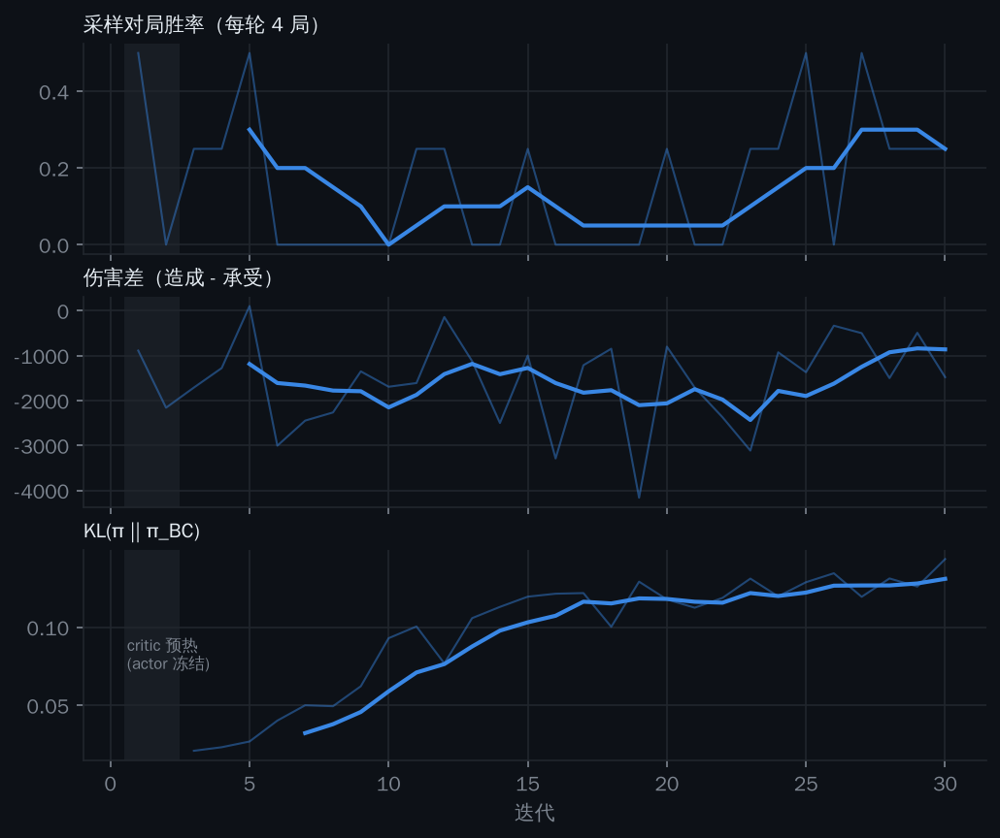

# Arena-1 仿真闭环：离线策略的闭环评估与 MAPPO 微调

离线评估回答不了"策略放进比赛里到底行不行"（见 README [评估的局限](../../README.md#评估的局限)）：FQE 只会因偏离日志而扣分，严格的重要性采样在 420 步时域上方差发散。本报告把 [Arena-1](https://github.com/RM-Arena/Arena-1)（RMUC 2026 / 2027 仿真器，Rust 物理与裁判判定）接成闭环，让三个用官方数据训练的战术策略（BC / IQL / DT）真正上场，再用 MAPPO 在仿真里在线微调。

> 仿真不是真实赛场。Arena-1 的规则由 AI 按手册实现、底盘与弹道参数是公开假设、没有飞镖 / 雷达 / 电子对抗；对手是 Arena-1 自带的脚本策略而非人类队伍。下文的每个结论都只在这个仿真器里成立，用来**排序方法**和**发现部署问题**，不是对真实胜率的预测。

## 摘要

| 结论 | 证据 |
|---|---|
| 闭环里 **IQL 相对 BC 没有可测量的提升** | 同局配对，伤害差 −377（95% CI −895 ~ +38），胜率差 +0.08（CI −0.25 ~ +0.42）；与离线 FQE 的结论一致 |
| 按 `deploy.decode_action` 的 0.5 阈值部署，三个离线策略都**显著不如**脚本步兵 | 伤害差相对脚本：BC −853（CI −1825 ~ −140）、IQL −1230、DT −792，CI 均不跨 0 |
| 落后主要出现在**交战门控的解码**上 | 门控改为按 `p_fire` 采样或常开后，BC / DT 与脚本的差距不再显著；同一策略两种解码的直接对比只有 DT 达到显著（采样相对阈值 BC +780，CI +196 ~ +1639） |
| **视野受限**（只知道己方相机看到的敌人）没有让 BC 变差 | BC·采样 −506 → 加视野受限 −447（相对脚本） |
| 三处**部署隐患**，真机同样存在 | 常量列被 1e-3 标准差放大上千倍；`ego.ammo` 是累计发弹而非剩余弹量；`p_fire` 是发射率而非许可 |
| MAPPO 微调 30 轮（120 局、约 15 万智能体步）**没有可测量的提升** | 相对 BC（同为采样开火）伤害差 −34（CI −526 ~ +527）；策略几乎没动：同一状态上 `p_fire` 0.182 → 0.190，导航子目标平均偏移 0.5 m |
| 离线流水线在**仿真对局数据**上原样可用 | 81 局脚本对局 → 同一套 build / train，替身策略落在与真实权重相同的区间，彼此无一致的高下 |

## 1. 接入方式

代码在 [`rm_rl/sim/`](../../rm_rl/sim/)，Arena-1 作为外部依赖（非商业学习许可，不随本仓库分发），设置 `ARENA1_ROOT` 指向编译好引擎的 checkout 即可。

| 模块 | 作用 |
|---|---|
| `arena.py` | 直接驱动 Rust 引擎（不经官方 runner 的 200 ms 截止），把 Arena-1 自带脚本策略作为模块导入，负责队内消息转发 |
| `referee_log.py` | 每个引擎帧 → 官方 SQLite 同格式的逐秒裁判日志（`matches` / `timeseries` / `events`，中文列名） |
| `export_sqlite.py` | 脚本对局批量导出为 SQLite，**原封不动的**离线流水线（vis_map → team_prior → build_dataset → 训练）可直接在上面跑 |
| `obs_adapter.py` | 在线观测：用至今记录的日志行重建 `GameArrays`，调用同一个 `features.build_obs`，取最新一行 |
| `control.py` | 战术动作（1 Hz）→ 10 Hz 机器人指令：`sdk.navigate` 走向子目标、`aim_at` / `aim_pitch` 瞄准所选敌人、满足门控 / 热量 / 弹道 / 对准时开火；买弹、复活等机构操作沿用队伍脚本 |
| `episode.py` | 一局闭环：策略接管 3 / 4 / 7 号步兵（7 号是 Arena 2026 里替代哨兵的步兵，填官方日志的"哨兵"列），其余机器人由队伍脚本控制 |
| `reward.py` | 奖励直接是 `reward.compute_reward` 作用在仿真日志上，沿用每个 run 自己 `meta.json` 里的权重 |

**一致性**：`python -m rm_rl.sim.check_parity` 用随机策略打一局、记录每个智能体在线拿到的 161 维观测，再把这局写成 SQLite、用 `build_dataset.load_game_arrays` 读回并重建。红蓝两方多次运行，**观测与奖励的最大差均为 0**——在线观测与离线观测走的是同一段代码。

**坐标方向**：两边都是 28 × 15 m、红方基地在左、180° 旋转对称。y 轴是否翻转用真实交火图验证：真实比赛中己方机器人有 **17.1%** 的时间位于 Arena-1 红方补给区 / 前哨 / 公路 / 隧道 / 飞坡所在的 6 个 2 m 格子；若 y 翻转只剩 6.6%（均匀分布 5.4%）。因此无需翻转（`RefereeLog(flip_y=...)` 保留了开关）。

**速度**：单核一局 420 s 约 270 s 墙钟（≈1.5 倍实时），物理步进占约 80%；每次战术决策（3 个智能体）约 70 ms，DT 约 85 ms。

## 2. 闭环里暴露的三个部署问题

这三个问题都是在闭环中逐个定位的；离线指标看不到其中任何一个。原始数据按版本保留在本目录：`results_real_v1_unmapped.jsonl`（修正前）、`results_real_v2_noresupply.jsonl`（无补给规则）、`results_real.jsonl`（最终，含 MAPPO）、`results_sim.jsonl`（仿真替身）。

### 2.1 常量列被放大上千倍（导出映射，已修正）

官方日志里有若干列恒为常数：空中机器人底盘功率恒 0、空中 / 哨兵恒为满档血量（100 / 400）、英雄 17mm 热量上限约 49。`build_dataset` 对标准差做了 1e-3 的下限，常量列的任何偏离都会被放大约 1000 倍。Arena-1 的原始值（空中飞行功率约 1.3 kW、7 号位是 200 血步兵）落在训练分布外：

| 列 | z（修正前） |
|---|---|
| `ally/enemy[空中].power` | ≈ 11 000 |
| `ally/enemy[空中].tier` | ≈ 990 |
| `ally/enemy[哨兵].tier` | ≈ 33 |
| `ally/enemy[英雄].heat17max` | ≈ 9 |

结果是 IQL **整局输出同一个指令**（`p_fire` 恒 0，目标恒为"工程"）——与 README 里"加 `is_ego` 后部署到哨兵输出恒定"是同一种失效。`RefereeLog` 现在按官方日志的约定写这些行（空中 100/100 血、0 W；7 号位血量与热量按哨兵 400 / 260 的上限折算比例；英雄 17mm 上限 50），修正后在线观测最大 |z| ≈ 3。

**对真机部署的启示**：车载观测只要有一列与训练时的常数不同（传感器默认值、单位、缺省填充），同样会让策略饱和。建议在 `deploy` 里对归一化后的观测截断（如 ±5σ），或在训练时直接剔除常量列。

### 2.2 策略看不到剩余弹量（加入补给规则）

Arena-1 2026 规则下步兵开局无弹，须回补给区购买。追踪"常开火"BC 的开火链条：存活时间里 **56% 无弹**、36% 受热量限制、真正开火 2%。原因是观测里的 `ego.ammo` 是**累计发弹量**——官方日志不记录剩余弹量——策略无从知道自己打空了，也就学不到"回去补弹"。随机策略在出生点附近游走、经常经过补给区，反而补到了弹，这正是 v2 里"离线策略不如随机"的主因。

补给不是战术层能观测的决策，因此像自瞄一样交给车载规则：弹量为 0 时由队伍脚本接管该机器人（回家买弹，与脚本步兵完全相同），补到弹后恢复策略指令。所有对照组共用此规则，结果中的 `resupply_frac` 记录接管时间占比。加入后"常开火"BC 的无弹时间降到 6%。

### 2.3 交战门控：发射率不是许可（作为评估变量）

门控标签是"这一秒有没有发弹"（约 16% 的存活秒），`p_fire` 是被校准到这个发射率的概率。`deploy.decode_action` 用 `p_fire > 0.5` 当作开火许可：

| 策略 | 闭环中 `p_fire` 均值 | `> 0.5` 的秒数占比 |
|---|---|---|
| BC | 0.214 | 8.7% |
| IQL | 0.097（优势加权把它压低了） | 0.7% |

阈值化会把伯努利概率塌缩成"几乎不开火"。这与 [Jev 报告](../../jev_demo/REPORT.md)中"门控阈值须按正类率定（约 0.23），不能用 0.5"的结论一致，这里给出了闭环证据。评估里把门控解码作为变量：`threshold`（0.5，部署代码）、`sample`（按 `p_fire` 抽样）、`auto`（常开，诊断用：只比较走位与选目标）。

## 3. 闭环评估（真实权重）

**设置**：策略接管 3 / 4 / 7 号步兵，英雄 / 工程 / 空中由 `claude_opus55_xhigh_team` 脚本控制；对手三档强度——`claude_opus55_xhigh_hold`（弱）、`claude_opus55_xhigh_team`（同脚本镜像）、`siege_team`（强）；每个对手 2 个种子 × 红蓝两边 = 每组 12 局，所有组在完全相同的（对手, 种子, 边）上配对。观测为全信息（与训练一致），`vision` 组只保留己方相机可见的敌人位置。


| 组 | 胜-平-负 | 胜率 | 造成 | 承受 | 相对脚本的伤害差（配对 95% CI） |
|---|---|---|---|---|---|
| 脚本（参照） | 6-0-6 | 0.50 | 1529 | 2802 | — |
| 随机 | 6-0-6 | 0.50 | 1345 | 2904 | −286（−995 ~ +296） |
| BC | 3-0-9 | 0.25 | 897 | 3023 | **−853（−1825 ~ −140）** |
| IQL | 4-0-8 | 0.33 | 856 | 3359 | **−1230（−2128 ~ −445）** |
| DT | 2-0-10 | 0.17 | 784 | 2849 | **−792（−1862 ~ −99）** |
| BC·采样开火 | 5-0-7 | 0.42 | 1164 | 2943 | −506（−1443 ~ +256） |
| IQL·采样开火 | 4-0-8 | 0.33 | 1030 | 3391 | **−1087（−1971 ~ −234）** |
| DT·采样开火 | 3-0-9 | 0.25 | 1172 | 2518 | −73（−504 ~ +342） |
| BC·常开火（诊断） | 6-0-6 | 0.50 | 1077 | 2597 | −247（−1155 ~ +517） |
| BC·采样开火·视野受限 | 6-0-6 | 0.50 | 1174 | 2894 | −447（−1426 ~ +235） |

加粗 = 置信区间不跨 0。方法之间的直接对比（同局配对）：

| 对比 | 胜率差 | 伤害差（95% CI） |
|---|---|---|
| IQL − BC | +0.08 | −377（−895 ~ +38） |
| DT − BC | −0.08 | +61（−318 ~ +520） |
| BC·采样 − BC | +0.17 | +347（−613 ~ +1461） |
| DT·采样 − BC | +0.00 | **+780（+196 ~ +1639）** |
| BC·常开火 − BC | +0.25 | +606（−267 ~ +1598） |

**解读**

1. **IQL ≈ BC。** 离线结论"IQL / DT 相对纯模仿没有可测量的增益"在闭环里同样成立；IQL 甚至略差（它的 `p_fire` 被优势加权压低，开火更少），但不显著。
2. **落后主要出现在门控解码上。** 阈值部署下三者都显著不如脚本；改成采样或常开后，BC、DT 与脚本的差距不再显著，造成伤害从约 850 升到约 1170。同一策略两种解码的直接对比只有 DT 显著（BC 为 +347，CI 跨 0），因此更准确的说法是：在 12 局能检出的范围内，走位与选目标没有表现出比脚本更差，而阈值门控表现出了。IQL 是例外——采样后仍显著落后，因为它的 `p_fire` 本身偏低。
3. **胜负几乎由对手决定**：所有组打 hold 多胜、打 siege_team 全负，只有镜像对手能拉开胜率差，因此胜率的置信区间很宽，结论主要看配对伤害差。
4. **视野受限无害**：全信息训练的 BC 在只给可见敌人位置时没有变差，部署到只能自我感知的车上是可行的。
5. **没有任何离线策略超过脚本步兵。** 这与"离线 RL 学不过示范者"的理论上限一致；要超越，需要在线学习。

## 4. 仿真替身：离线流水线在仿真数据上

`export_sqlite` 让 Arena-1 自带的 10 套 2026 全队脚本（4 套 Claude、6 套 siege，各算一所"学校"）两两对打，写成官方同格式的 SQLite；`vis_map → team_prior → build_dataset → BC / IQL / DT` 全部原样运行、沿用 `configs/infantry_*_tactical.yaml`。81 局 → 292 条训练轨迹、121,556 条转移（真实数据的约 1/7）。

| 离线指标（held-out） | 仿真替身 BC | 真实 BC（README） |
|---|---|---|
| `nav_mse` | 0.055 | 0.060 |
| `fire_f1`（正类率） | **0.801**（0.153） | 0.375（0.161） |
| `target_top1_named` | 0.672 | 0.746 |

脚本"对准就开火"，门控在仿真数据里远比人类数据可预测（F1 0.80 vs 0.38）。闭环（采样开火，与真实权重同一组 12 局）：

| 组 | 胜率 | 相对脚本的伤害差 | 相对同算法真实权重 |
|---|---|---|---|
| 替身 BC | 0.08 | −667（−1659 ~ +214） | −161（−491 ~ +139） |
| 替身 IQL | 0.25 | −118（−702 ~ +557） | +969（−53 ~ +2072） |
| 替身 DT | 0.25 | **−1037（−2079 ~ −227）** | **−964（−2028 ~ −101）** |

替身与真实权重之间没有一致的高下（BC 持平、IQL 偏好替身、DT 偏好真实），都没有超过脚本。这一节的价值在于工程：**没有官方数据也能把整条流水线跑通**，导出器也可用于数据增广或在仿真里构造特定对局分布的训练集。

## 5. MAPPO 微调

**设置**（[`algos/mappo.py`](../../rm_rl/algos/mappo.py)、[`train/train_mappo.py`](../../rm_rl/train/train_mappo.py)）：

- **actor**：三台步兵共享一个 `HybridPolicy`，从真实 BC 的 `best.pt` 初始化，只看自己的 161 维观测（可部署的输入）；训练时三个头都按分布采样（新增的 `sample()`）。
- **critic**：中心化价值函数，输入引擎快照里的特权状态——该智能体视角的全信息 161 维 + 全部 12 台机器人的弹量 / 热量 / 等级 + 双方金币与输出（201 维）；只在训练时存在。价值归一化（MAPPO 论文做法）。
- **先验约束**：损失加 `0.05 · KL(π ‖ π_BC)`（`HybridPolicy.kl()`，三个头解析计算），对冻结的 BC 拷贝计算。
- **奖励**：`reward.compute_reward` 作用于仿真日志，权重取 BC run 的 `meta.json`（与离线训练同一目标）。
- **对手**：9 套脚本随机抽、随机边；`siege_team` 留作评估用的未见对手。每轮 4 局（4 进程并行），GAE（γ 0.99，λ 0.95），PPO 5 epoch、clip 0.2，actor lr 5e-5，前 2 轮只训 critic。共 30 轮。



训练本身健康：critic 解释方差从 0 升到 0.7–0.9，每次更新 approx-KL ≈ 0.01、clip 比例 ≈ 0.13，KL 到 BC 平稳升到 0.13。采样对局的胜率 / 伤害差逐轮噪声很大（每轮 4 局、对手随机），看不出可信趋势。

**闭环评估**（同一组 12 局）：

| 组 | 胜率 | 相对脚本 | 相对 BC（同一门控解码） |
|---|---|---|---|
| MAPPO（0.5 阈值） | 0.17 | **−1629（−2807 ~ −620）** | **−776（−1446 ~ −194）** |
| MAPPO·采样开火 | 0.17 | −540（−1335 ~ +140） | −34（−526 ~ +527） |

**它改了什么**：在同一批 1,136 个 BC 访问过的状态上对比两者的输出——`p_fire` 均值 0.182 → 0.190（相关 0.976）、目标分布几乎不变、导航子目标平均偏移 0.5 m、探索标准差不变。KL 0.13 基本来自这点导航偏移。

**解读**：在这个预算下 MAPPO **没有产生可测量的提升**。阈值解码那一行的显著变差值得存疑——策略几乎没动，而本报告做了二十余组配对比较，95% 水平下出现一两个假阳性是预期内的；采样解码下与 BC 完全持平（−34）。原因不难理解：

- **样本太少**：约 15 万智能体步（120 局），而在 1 Hz、420 步时域、5 种对手风格的问题上，PPO 一般需要多一到两个数量级；以单核约 1.5 倍实时计，这台 4 核机器一小时只能跑约 35–50 局。
- **回报方差大**：对手强弱悬殊（打 siege 系列几乎必输），每轮 4 局的对手组合本身就主导了回报。
- **训练 / 评估模式不同**：训练时三个头都在采样，评估时导航与目标取确定值。

要让在线微调真正起作用，优先级依次是：仿真提速（引擎训练模式、跳过逐 tick 快照序列化、更多核）、按对手分组的课程与固定对手池、更长训练；以及先修正动作空间里的两处语义问题（门控标签、剩余弹量），否则在线学习要先花样本去弥补它们。

## 6. 局限

- **样本量**：每组 12 局，只能检出较大的效应（伤害差约 800 以上）。胜率差几乎都不显著。
- **多重比较**：报告中有二十余组配对比较，均未做多重比较校正；单个"显著"结果应结合其它证据看待（如 §5 的阈值 MAPPO）。
- **对手池小且强弱悬殊**：三个评估对手、九个训练对手都来自 Arena-1 自带脚本。
- **控制器是替身**：导航、自瞄、补给规则用 Arena SDK 实现，与各队真车上的导航栈 / 自瞄不同；策略的好坏部分取决于这一层。
- **规则与物理是仿真**：Arena-1 由 AI 按手册实现（Beta），2026 场地里 7 号位是步兵而非哨兵，空中机器人不可被攻击，热量上限、经济数值与真实赛事未逐项核对；`vuln`（雷达易伤）恒为 0。
- **1 Hz 决策**：沿用离线框架的战术层频率，未探索更高频率。
- **MAPPO 只跑了一次**（单个随机种子、30 轮），超参未搜索。

## 7. 复现

```bash
# Arena-1：git clone https://github.com/RM-Arena/Arena-1 && cargo build --release --manifest-path simulation/Cargo.toml
export ARENA1_ROOT=/path/to/Arena-1 OMP_NUM_THREADS=1
python -m rm_rl.sim.check_parity --vis-map data/vis_map.npz          # 在线 / 离线观测一致性
python -m rm_rl.eval.closed_loop --out rm_runs/closed_loop --vis-map data/vis_map.npz \
    --opponents claude_opus55_xhigh_hold,claude_opus55_xhigh_team,siege_team --seeds 2 --workers 4 \
    --arm script --arm random --arm bc=rm_runs/infantry_bc_tactical --arm iql=rm_runs/infantry_iql_tactical \
    --arm dt=rm_runs/infantry_dt_tactical --arm bc_sample=rm_runs/infantry_bc_tactical:sample
python -m rm_rl.train.train_mappo --init rm_runs/infantry_bc_tactical --vis-map data/vis_map.npz \
    --out rm_runs/mappo_from_bc --iters 30 --workers 4
python -m viz.sim_figures --closed-loop rm_runs/closed_loop/results.jsonl --mappo rm_runs/mappo_from_bc
# 或一键：bash scripts/sim_experiments.sh（SIM=1 用仿真替身数据）
```
