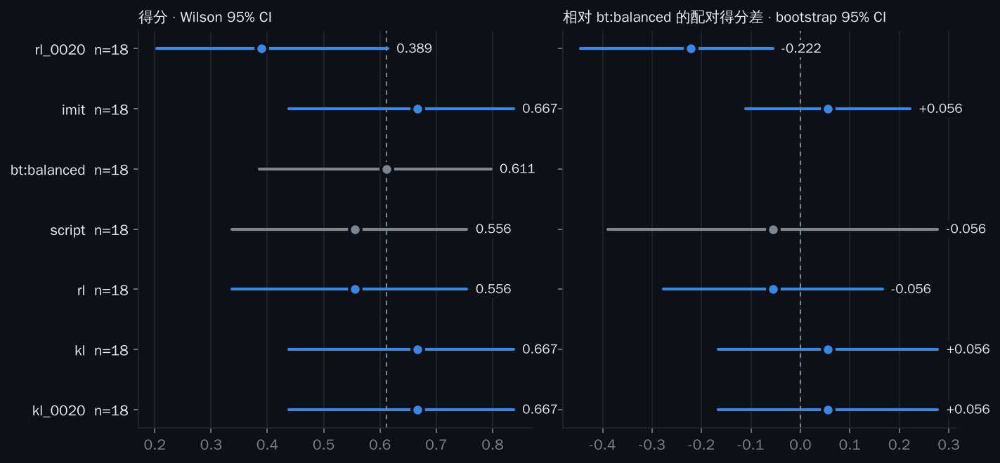

# 2027 哨兵决策层：在 Arena-1 里训练，换掉实车行为树

**目标**：
1. 实车哨兵的决策层由 RL 策略接管，并且表现**胜过行为树**；
2. 在模拟器里，战术水平**超过人类编写的策略**。

本文说明为什么做成现在这样、各部分接口、训练和评估流程、服务器上怎么跑，以及上实车的步骤。

## 1. 为什么不沿用 161 维的离线框架

- **Arena-1 默认已经是 RMUC 2027 规则**（2026-10-15 发布的 V1.0.0）。2027 的机制和往届差别很大：
  - 控制点与控制度是第一判胜条件；
  - 英雄和工程合并为重型机器人；
  - 哨兵全自动，有攻击/防御/移动三种姿态，有 15 秒强化预算，每分钟在补给区领 100 发配给；
  - 17mm 弹丸全队每局最多兑换 1000 发。

  161 维特征来自往届裁判日志，表达不了这些机制。2027 也还没有任何人类比赛数据。
- **实车上能被 RL 接管的是哨兵的决策层。** 哨兵的软件栈是"感知 → 决策 → 导航/自瞄"，行为树就在中间这一层。所以动作接口直接定义成行为树输出的东西：去哪个点、自瞄优先打谁、姿态、补弹/回血/复活。策略和行为树在同一个接口上可以互换，这也是实车上替换的方式。

## 2. 结构

```
裁判系统 + 自身感知 ──► 快照 (inputs.py) ──► ObsBuilder (obs.py) ──► 策略 / 行为树 ──► 宏动作
                         ▲ 仿真里由 Arena 观测填写                                        │
                         └ 实车上由裁判系统 + 自瞄检测填写                                   ▼
                                                    执行器 (executor.py)：导航 + 自瞄 + 指令
                                                    实车上换成自己的 nav2 / 自瞄 / 裁判系统指令
```

| 模块 | 作用 |
|---|---|
| `rm_rl/arena27/spec.py` | 队伍坐标系（蓝方中心对称映射到红方）、18 个目标、5 个动作头，版本号 `SPEC_VERSION`（v2）；每个训练好的 run 都会导出 `spec.json` |
| `rm_rl/arena27/inputs.py` | 决策输入快照：明文字段，实车可以逐项填写（见第 6 节） |
| `rm_rl/arena27/obs.py` | 快照 → 258 维特征（截断到 ±5）、动作掩码、目标持续机制、critic 用的特权全局状态（342 维） |
| `rm_rl/arena27/executor.py` | 宏动作 → 10 Hz Arena 指令，扮演实车导航和自瞄的角色；策略、行为树、随机共用同一个执行器 |
| `rm_rl/arena27/bt.py` | 行为树基线：`balanced` / `guard` / `assault` / `raid`，和策略在同一个动作空间里 |
| `rm_rl/arena27/match.py` | 一局比赛：双方都是整队脚本，任意 (队伍, 号位) 可以交给决策者接管，支持自博弈 |
| `rm_rl/algos/macro_ppo.py` | 带掩码的多离散 PPO：观测归一化内置在策略里，critic 是中心化的 |
| `rm_rl/train/train_sentry27.py` | 先模仿行为树，再做 PPO 自博弈加对手联赛；异步采样 |
| `rm_rl/eval/eval_sentry27.py` | 配对评估，给出 Wilson 区间和配对 bootstrap 置信区间 |
| `rm_rl/arena27/deploy.py` | 实车运行时：纯 numpy 推理，任何异常都回退到行为树 |
| `rm_rl/arena27/selftest.py` | 开跑前的自检 |
| `scripts/sentry27.sh` | 服务器一键流水线 |
| `viz/sentry27_figures.py` | 训练曲线图和评估图 |

### 动作（每 1 秒决策一次；目标头带持续机制）

| 头 | 选项 | 实车上对应 |
|---|---|---|
| goal | hold、chase，以及 16 个命名点：己方中央高地卡 / 前哨卡 / 高地低端 / 堡垒卡 / 基地卡 / 补给区 / 公路 / 制高点，敌方中央高地卡 / 前哨卡 / 高地低端 / 堡垒卡 / 公路 / **基地卡后侧**，**南、北两条侧路** | 导航目标点（`spec.json` 给出红蓝两方的世界坐标） |
| target | 最近 / 最弱 / 重型优先 / 建筑优先 / **只打 6 米内** / 不开火 | 自瞄的目标优先级和开火许可 |
| posture | 保持 / 攻击 / 防御 / 移动 | 哨兵姿态指令 |
| enhance | 关 / 开 | 姿态强化 |
| supply | 无 / 兑换弹丸 / 远程回血 / 立即复活 | 兑换、回血、复活指令 |

动作掩码会屏蔽做不到的选项：姿态冷却中、兑换条件不满足（不在兑换卡上又没脱战、金币不够、全队 1000 发上限已满）、全向轮哨兵上不了制高点、阵亡时只能选复活，以及 `--forbid-goals` 禁用的目标（例如真实规则不允许的打法）。

**目标持续**（`--goal-dt`，默认 5 秒）：选中的目标会一直保持，直到"到达后又停留了 goal_dt 秒"、或已过 60 秒、或被打断（阵亡/复活、变虚弱、血量跌破 30%）；保持期间目标头只有这一个选项，其余四个头仍每秒决策。这样一次选择就能代表一整个计划（比如 40 秒的偷基地），探索才有意义。观测里有当前目标、是否可重选、已持续多久、是否已到达。行为树不受这个限制，按原样每秒决策。

### 奖励

- 控制度领先的增量 × 0.02，对应 2027 第一判胜条件，**不退火**；
- 全队伤害领先的增量 / 2000，对应第二判胜条件；
- 阵亡 −0.5；
- 终局胜 +10、负 −10、平 0。

伤害和阵亡两项的系数随训练从 1 线性退火到 0.3。v1 里还有"哨兵自身造成的伤害 / 1000"，每局稳定贡献约 +2，奖励的是开火而不是赢，v2 已去掉（`--reward own_damage=...` 可恢复）。

## 3. 训练

1. **模仿阶段**（默认 6 次更新）：学习者席位由 `--imitate` 指定的行为树驾驶，在和策略相同的目标持续规则下运行；策略拟合它的选择，critic 同时学习价值。日志里的 `imit_acc` 是五个动作头全部和行为树一致的比例。之后的 PPO **从行为树的水平起步**。
2. **PPO 自博弈与联赛**：
   - 每局随机抽己方整队脚本和对方整队脚本，来自 15 套训练用脚本，覆盖各种队友和对手风格；学习者随机分到红方或蓝方。
   - 对方哨兵按比例抽取：35% 镜像（当前策略本身，双方轨迹都参与训练）、30% 历史快照（按 PFSP 优先选还能赢学习者的快照）、15% 行为树（含 `raid`，学会守自己的基地卡）、20% 对方脚本自带的哨兵。
   - 每 10 次更新存一个快照进联赛。
3. **探索（v2）**：
   - 目标持续机制（见第 2 节）：一次采样就是一整个计划；
   - **自适应熵系数**：把策略熵维持在 `--target-entropy`（默认 0.5 nat，全部头合计），低于目标就加大熵奖励，高于就减小；
   - **默认不加 KL 锚定**（`--prior-kl 0`）：服务器上的大批量 PPO 很稳（approx_kl 约 0.01），锚定只会把策略钉在行为树上。开发环境里每次更新只有 6 局时，不加锚定会先变差（第 9 节），所以小批量实验要加回 `--prior-kl 0.1 --prior-kl-final 0.01`。
4. **异步采样**：每个 worker 连续打完整的 420 秒比赛，开局时使用当时最新的策略；学习器只用策略版本落后不超过 1 的数据（PPO 的比率用的是记录下来的行为对数概率）。

需要关注的日志列：

| 列 | 说明 |
|---|---|
| `imit_acc` | 模仿阶段末应该 ≥ 0.9 |
| `score_script` / `score_bt` / `score_snapshot` / `score_mirror` | 学习者对各类对手的得分（采样策略，含探索）；镜像对局双方都是当前策略，期望 0.5 |
| `entropy`、`approx_kl`、`clipfrac`、`explained_var` | PPO 健康度：approx_kl 多在 0.03 以下（超过就提前结束该次更新），explained_var 应升到 0.5 以上 |
| `ent_coef` | 自适应熵系数；长期顶在上限 0.05 而熵仍低于目标，说明动作被掩码限制得很死 |
| `kl_prior` | 离模仿策略有多远（只有开了 `--prior-kl` 才有） |
| `seat_no_ammo`、`seat_own_central`、`seat_enemy_base`、`seat_deaths` | 哨兵行为：无弹、在己方中央高地卡、在敌方基地卡、阵亡次数 |
| `errors`、`stale` | 采样异常和被丢弃的过期对局数 |

## 4. 评估（结论只看这个，不看训练日志）

- **评估环境**：7 套**训练中从没出现过**的队伍脚本（`EVAL_TEAMS`），同时用作队友和对手。
- **对局网格**：7 × 7 种组合 × 2 个种子 × 红蓝两边 = 每个参与对比的版本 196 局（`RULES=conservative` 时去掉 2 套偷基地的脚本，5 × 5 × 2 × 2 = 100 局）。
- **配对控制**：所有版本在相同的对局网格上比较，己方都用同一型号的哨兵（默认 2771），对方哨兵都由对方脚本自己驾驶。
- **参与对比的版本**：
  - `script`：己方队伍脚本自带的哨兵；
  - `bt:balanced` / `bt:guard` / `bt:assault` / `bt:raid`：四棵行为树（`raid` 只在 `RULES=arena` 下出场）；
  - `random`：随机合法动作；
  - `rl`：训练好的策略，贪心执行；
  - `rl_XXXX`：中间检查点。
- **判据**：相对**最强的那棵行为树**的配对得分差，95% 置信区间下界 > 0。`RULES=arena` 下是 `bt:raid`，`RULES=conservative` 下是 `bt:balanced`（如果基线评估里 `assault` 更强，就换成它）。同时报告控制度领先和伤害领先的配对差。
- **统计功效**：配对得分差的标准差约 0.6，196 局时 95% 置信区间的半宽约 ±0.08。
- **移植你们自己的行为树**（建议做）：在 `bt.py` 里写一个函数 `f(inp, wps, last_supply=...)`，从快照映射到各动作头的选项名，加进 `TREES`，然后用 `--ref bt:<名字>` 作为参照。"胜过行为树"最有说服力的版本，就是胜过你们自己队的这一棵。

## 5. 在服务器上跑

服务器配置：4 × RTX 5880 Ada、144 核、128 GB 内存。

- **瓶颈是 CPU。** 2027 规则下单核约 1 倍实时，物理引擎占约 75%。每个 worker 约 500 MB 内存，136 个 worker 约 70 GB。
- **吞吐估算**：136 个 worker 每小时约 1100 局，约 60 万个学习者决策步，一天约 1500 万步。默认 300 次更新约需 1.5 天。
- **GPU 基本用不上**：学习器的更新很小，单卡足够。开第二组种子会和第一组分 CPU，并不会更快。

```bash
ARENA1_ROOT=/path/to/Arena-1 RULES=arena bash scripts/sentry27.sh          # 自检 → 基线评估 → 训练 → 评估
STAGE=train ARENA1_ROOT=... RULES=arena bash scripts/sentry27.sh            # 只跑某一阶段（可续跑）
python -m viz.sentry27_figures --train rm_runs/sentry27_v2_arena --eval rm_runs/sentry27_v2_arena_eval \
    --ref bt:raid --out viz/figures
```

`RULES` 必须显式给出（见第 10 节"偷基地"）：`arena` 允许策略学偷基地，从 `raid` 行为树起步；`conservative` 把这条路连同相关的队伍脚本全部去掉，从 `balanced` 起步。

## 6. 上实车

1. **写快照适配器**：把裁判系统数据和自身感知填成 `inputs.py` 的字段。来源对照如下（命令号参考往届串口协议，以 2027 新版协议为准）：

   | 快照字段 | 实车来源 |
   |---|---|
   | time | 比赛状态（0x0001）里的剩余时间 |
   | self.hp / max_hp / heat / max_heat / level | 机器人状态（0x0201）和功率热量（0x0202） |
   | self.ammo | 允许发弹量（0x0208） |
   | self.x / y / heading | 己方位置（0x0203） |
   | self.posture / posture_ready_at / 强化时间 | 哨兵相关信息（往届 0x020D），2027 姿态字段以新协议为准 |
   | self.on_exchange / in_supply | RFID 状态（0x0209） |
   | self.last_damage_time / last_shot_time | 伤害状态（0x0206）、射击数据（0x0207） |
   | mates | 己方地面机器人位置（0x020B）和全场血量（0x0003） |
   | enemies | 全场血量（0x0003） |
   | seen | 自瞄检测到的敌方装甲，转换到场地坐标 |
   | bases / outposts / positions | 血量和场地事件（0x0101），2027 控制点字段以新协议为准 |
   | economy | 金币和已兑换量（0x0208、哨兵信息） |

2. **调用运行时**：
   ```python
   rt = SentryRuntime("rm_runs/sentry27/latest", team, 7)
   cmd = rt.decide(snapshot)   # 每秒一次
   ```
   - `cmd["goal_xy"]` 发给导航；
   - `cmd["target"]` 设定自瞄优先级和开火许可；
   - `posture` / `enhance` / `supply` 转成裁判系统的哨兵指令（往届是 0x0120 哨兵自主决策命令）。

   运行时是纯 numpy，不需要 torch，和 torch 的贪心动作已逐项核对一致。出现任何异常都回退到行为树，次数记在 `rt.fallbacks`。
3. **影子模式**：先只记录策略的决策、不执行，和行为树的决策对比，确认输出分布正常、没有回退。
4. **练习赛 A/B**：行为树和策略交替上场，按局统计结果。
5. **闭环校准**：拿实车日志对比仿真里的统计，比如命中率、弹量消耗、在卡时间。偏差大的地方回去调整执行器或仿真参数，然后重新训练。

## 7. 已知局限

- **仿真本身不完全真实。** Arena-1 的规则是 AI 按手册实现的，物理、命中和视觉都是近似。RL 会利用规则实现里的漏洞，所以要定期看回放；出现"始终不开火""卡在某处不动"这类异常行为要排查。
- **执行器不等于实车的导航和自瞄。** 实车的执行特性（导航成功率、自瞄命中率随距离的变化、延迟）需要实测，再写进执行器，或者做成随机化参数。
- **敌人位置默认只来自哨兵自己的相机**（`own` 模式），和实车一致。如果实车有雷达或队友共享，可以用 `--enemy-info team` 训练。
- **训练用的哨兵型号是 2771（全向）。** 你们实车更接近哪一款，就用 `--sentry-model` 指定。
- **Arena-1 是非商业学习许可**，只能作为外部依赖使用，不要放进本仓库，也不要修改。
- **"偷基地"是否合法要先核对 2027 规则手册**（第 10 节）。如果真实规则不允许，就用 `RULES=conservative`，否则策略学到的是只在仿真里成立的打法。
- **敌人信息不对等**：队伍脚本的哨兵用的是全队相机看到的敌人，我们的哨兵（行为树和策略）只用自己的相机。比较"脚本哨兵"和"我们的哨兵"时要记住这一点；实车如果能拿到队友或雷达的信息，可以用 `--enemy-info team` 训练并对比。

## 8. 下一步：全队战术与人类基准

- **全队战术**：`--slots 3,4,7` 让同一个策略同时控制两台步兵和哨兵（观测里有兵种 one-hot，代码已支持并做过冒烟测试）。步兵目前没有对应的行为树可以模仿，可以用 `--imitate ''` 从零开始训练，或者先训好哨兵再扩展。
- **"超过人类"的度量**：
  - 一是和人类编写的 Arena 策略对打；
  - 二是做一个战术指挥台，让人用同一套宏动作实时指挥 3/4/7 号位（仿真速度 ≥ 1 倍实时，可行）。指挥台尚未实现。

## 9. 开发环境中的验证（4 核，只验证流程，不代表最终效果）

正式训练需要服务器；这里只回答"流程对不对、默认设置稳不稳"。逐局结果和日志在 [`dev_validation/`](dev_validation/)。

- **自检全部通过**（`python -m rm_rl.arena27.selftest --run ...`）：特征和 critic 状态有限，记录的动作全部合法，numpy 运行时和 torch 贪心动作一致（另外 500 组随机输入 500/500），运行时能从实时快照决策且不回退。
- **完整 420 秒对局**跑通，决策每次约 1 ms。行为树最初有一半以上时间无弹：2027 每队只能兑换 1000 发，哨兵守在中央高地卡上又达不到远程兑换要求的脱战。补上"去己方前哨卡就地兑换 / 回补给区领配给"的规则，并把全队剩余可兑换量放进观测和掩码后才正常。这说明弹药管理正是策略可以超过行为树的地方。
- **模仿**：8 次更新（约 6000 个样本）后，在没见过的队伍脚本对局上，五个头全部与行为树一致的比例为 0.886（goal 0.92、target 1.00、posture 0.96、enhance 0.99、supply 0.99）。
- **全长基线**（420 秒，8 局配对）：行为树得分 0.50，队伍脚本自带哨兵 0.375，差 −0.125，置信区间 [−0.375, 0]；样本太少，没有结论。
- **不加锚定的短程 PPO**：90 秒短局，3 个 worker，每次更新 6 局，共 30 次。在 3 × 3 套留出队伍脚本、红蓝两边的 18 局配对评估中：

  | 对象 | 相对 `bt:balanced` 的得分差 [95% CI] | 控制度差 |
  |---|---|---|
  | 模仿结束（第 8 次） | +0.056 [−0.11, +0.22] | +0.9 |
  | PPO 第 20 次 | **−0.222 [−0.44, −0.06]** | −7.2 |
  | PPO 第 30 次 | −0.056 [−0.28, +0.17] | −0.8 |

  模仿忠实复现了行为树；之后的小批量 PPO 先把贪心策略推坏，后来才恢复。因此 v1 把锚定和小熵奖励设成了默认值（v2 的取舍见第 3 节）。
- **加锚定后重跑**（v1 当时的默认值，其余设置和任务序列完全相同）：

  | 对象 | 相对 `bt:balanced` 的得分差 [95% CI] | 控制度差 |
  |---|---|---|
  | PPO 第 20 次 | +0.056 [−0.17, +0.28] | +2.1 |
  | PPO 第 30 次 | +0.056 [−0.17, +0.28] | +2.1 |

  第 20 次时，加锚定的比不加的高 +0.278 [+0.06, +0.56]（同一组对局配对比较）：前期掉到行为树以下的情况消失了。策略熵稳定在 0.3 左右，`kl_prior` 在 0.05–0.1 之间。


- **还不能回答的问题**：PPO 能不能**超过**行为树。每次更新只有 6 局 90 秒短局，信号太弱；而且 18 局配对评估只能检出约 0.2 以上的得分差。服务器上每次更新 136 局完整比赛，样本量是这里的 100 倍以上，评估每臂 196 局。


## 10. 第一次正式训练（v1，300 次更新）的结果与诊断

服务器上按 v1 设置训练了 300 次更新（40,800 局，0 错误），在 7 套留出队伍脚本上每臂评估 196 局，结果在 `rm_runs/sentry27_eval/`：

| 对象 | 相对 `bt:balanced` 的配对得分差 [95% CI] | 控制度差 |
|---|---|---|
| `rl`（第 300 次） | +0.005 [−0.056, +0.071] | −6.1 |
| 各检查点 `rl_0050` … `rl_0250` | −0.005 ~ +0.026，置信区间全部跨 0 | −9 ~ +12 |
| `bt:assault` | +0.046 [−0.010, +0.102] | **+40.9** [+0.7, +80.2] |
| `script`（队伍脚本自带哨兵） | **+0.082** [+0.005, +0.158] | **+134.5** [+75.0, +195.7] |
| `random` | **−0.148** [−0.219, −0.082] | −96.3 |

**结论：策略始终停在行为树上，没有学到任何新东西。**

- **行为指标和行为树逐项相同**：阵亡 1.37 对 1.41，无弹 0.38 对 0.38，在己方中央高地卡 0.50 对 0.51。
- **训练曲线全程是平的**：模仿后策略熵只有 0.06 nat（五个头合计，几乎是确定性策略）；离模仿策略的 KL 只有 0.03–0.12；critic 的解释方差 0.97，价值估计不是瓶颈。
- **原因有三：**
  1. **探索塌缩**：模仿把策略压得几乎确定，0.003 的熵奖励加上 0.1 的 KL 锚定又把它钉住；
  2. **时间尺度不对**：每秒重新选目标，偶尔偏离一秒什么也改变不了。有意义的替代方案（例如"花 40 秒去敌方基地卡"）需要连续几十步的一致偏离，在几乎确定的策略下概率为零；
  3. **动作空间缺了最关键的目标**：见下文。

**"脚本哨兵比行为树强"几乎全部来自一支队伍。** 按己方队伍拆开，`script − bt:balanced` 的差异集中在 `dsv41_1017_sentry_dual_arm`（得分 +0.571，控制度 +785），其余 6 支在 −0.21 ~ +0.14 之间。这支队伍的哨兵沿南侧路绕到敌方基地后面，坐在**基地卡后侧**：在 Arena-1 的 2027 实现里，只要有己方机器人在敌方基地卡上、而敌方没有，5 秒后就临时占领了敌方基地控制点；同时控制双方基地控制点时，控制度每秒 +3，是前哨控制点的 3 倍。而 v1 的 15 个目标里**根本没有"敌方基地卡"**。

**在我们的执行器里复现**（开发环境，420 秒全长，4 套留出己方队伍 × 2 个对手 × 红蓝两边，16 局配对，见 `dev_validation/raid420_*`）：

| 对象 | 相对 `bt:balanced` 的得分差 [95% CI] | 控制度差 [95% CI] | 在敌方基地卡上 |
|---|---|---|---|
| `bt:raid` | **+0.375 [+0.125, +0.625]** | **+678 [+473, +860]** | 存活时间的 70% |

4 支己方队伍的控制度差全部为正（+523 ~ +830），胜局从 6/16 升到 12/16，阵亡从 1.75 降到 0.56。

**偷基地要先核对真实规则。** Arena-1 的配置里，敌方进入堡垒卡需要先控制对方前哨控制点，但基地卡没有这条限制。这可能符合真实规则，也可能是实现里的空子。上实车之前请对照 2027 规则手册里"基地控制点"的占领条件：

- 如果真实规则允许，用 `RULES=arena`，从 `raid` 起步；
- 如果不允许，用 `RULES=conservative`：禁用 `enemy_base` 目标，去掉 `raid` 行为树对手，并把 6 套偷基地的队伍脚本（`RAID_TEAMS`）从训练和评估里剔除。

## 11. v2 改了什么

| 问题 | v2 的改动 |
|---|---|
| 缺关键目标 | 目标头加入敌方基地卡后侧（`enemy_base`）和南、北两条侧路（`lane_south` / `lane_north`），执行器从出生点都能到达 |
| 每秒重选、偏离无意义 | 目标持续（`--goal-dt 5`）：一个目标保持到"到达后停留 5 秒 / 60 秒上限 / 被打断"；观测里加当前目标和持续状态 |
| 探索塌缩 | 自适应熵系数，把熵维持在 `--target-entropy 0.5`；默认不加 KL 锚定 |
| 奖励偏向开火 | 去掉"哨兵自身伤害"项；控制度项不退火 |
| 弹药浪费（无弹约 38%） | target 头加"只打 6 米内"，不打建筑 |
| 参照太弱 | 新增 `raid` 行为树作为基线和对手；判据改为对最强的行为树 |
| 偷基地可能不合法 | `RULES=conservative` / `--no-base-raids` / `--forbid-goals` |
| v1 / v2 混用 | `spec.json` 记录 `spec_version`；用 v2 代码评估 v1 run 会直接报错，并提示回到 `a3ced70` |

v2 的观测是 258 维（v1 是 228 维），critic 状态 342 维，目标头 18 个选项，target 头 6 个选项。v1 的 `rm_runs/sentry27/` 保留不动，v2 的输出在 `rm_runs/sentry27_v2_<RULES>/`。
